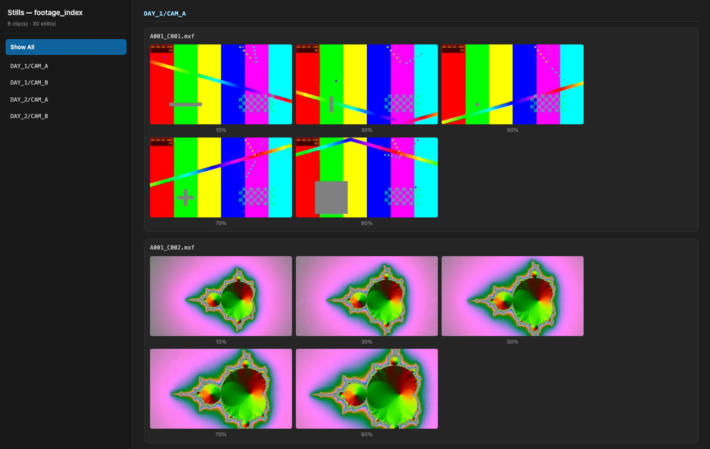

# Raw Footage Still Extractor


A fast, parallel CLI that extracts 5 representative low-resolution JPEGs (300px) from every video in a deep footage tree using FFmpeg fast-seeking, and builds a browsable two-pane HTML gallery — all in one command.

## Prerequisites

- **Python 3.10+** (declared as `requires-python = ">=3.10"` in `pyproject.toml`)
- **FFmpeg & FFprobe** available in `PATH`

> On macOS, Homebrew's build bundles both: `brew install ffmpeg`. Note the
> `.pkg` installer only updates `PATH` for *new* shells — an already-open
> terminal needs `eval "$(/opt/homebrew/bin/brew shellenv)"` or a new tab.

## Supported formats

The default scan covers 38 common video extensions, matched case-insensitively
(`.MP4` == `.mp4`):

```
.3g2 .3gp .asf .avi .divx .dv .f4v .flv .insv .lrv .m1v .m2t .m2ts .m2v
.m4v .mkv .mod .mov .mp4 .mpe .mpeg .mpg .mpv .mts .mxf .nuv .ogv .qt .rm
.rmvb .tod .tp .trp .ts .vob .webm .wmv .y4m
```

Override the set with `--extensions` (dots optional, commas separate):

```bash
uv run raw-footage-still-extractor "<ROOT>" "<OUT>" --extensions ".mp4,.mov,.mxf"
```

Because ffmpeg identifies containers by **content**, this list is only a *discovery* filter — it decides which files get probed, not what can be read. An unusual extension still probes fine once it is listed.

**Deliberately excluded:** camera-RAW formats ffmpeg cannot demux without vendor SDKs — `.braw` (Blackmagic), `.r3d` (RED), `.ari` (ARRI), `.crm` (Canon), `.dng` (CinemaDNG). Listing them would only produce guaranteed probe failures; transcode/proxy those first.

## Installation & Setup

Distributed **only via GitHub** — there is no PyPI package. Clone and run:

```bash
git clone https://github.com/sergiubrega/raw-footage-still-extractor
cd raw-footage-still-extractor
```

> The project is called `raw-footage-still-extractor`, but the **import package is
> `still_extractor`** — the same distribution-name ≠ import-name pattern as
> `beautifulsoup4` → `bs4` or `Pillow` → `PIL`.

The project is managed with [uv](https://docs.astral.sh/uv/), which provisions
Python 3.10 and the package into a local `.venv` automatically — **no manual
activation required**. `uv run` syncs the environment on first use and reuses it
afterwards.

```bash
uv run python -m still_extractor --help
```

You can also invoke the installed console script directly:

```bash
uv run raw-footage-still-extractor --help
```

<details>
<summary>Alternative: activate the virtualenv manually</summary>

To use a shell where `python` resolves to the project environment:

```bash
uv sync                    # create/update .venv from uv.lock
source .venv/bin/activate
python -m still_extractor --help
deactivate
```

Without `uv run` or activation, a bare `python -m still_extractor`
fails with `No module named still_extractor`: the package is only
importable once installed into the environment.
</details>

```
usage: raw-footage-still-extractor [-h] [-w WORKERS] [-e LIST]
                                   root_dir output_dir

Extract 5 stills (10/30/50/70/90%) from every video file under a root
directory into <output_dir>/stills/, then build <output_dir>/index.html — a
browsable gallery grouped by source folder.

positional arguments:
  root_dir              root folder to search recursively
  output_dir            output folder; receives index.html and a stills/
                        folder

options:
  -h, --help            show this help message and exit
  -w WORKERS, --workers WORKERS
                        number of worker processes (default: all CPU cores)
  -e LIST, --extensions LIST
                        comma-separated extensions to scan, replacing the
                        default set (e.g. ".mp4,.mov,.mxf"). Default: .3g2,
                        .3gp, .asf, .avi, .divx, .dv, .f4v, .flv, .insv, .lrv,
                        .m1v, .m2t, .m2ts, .m2v, .m4v, .mkv, .mod, .mov, .mp4,
                        .mpe, .mpeg, .mpg, .mpv, .mts, .mxf, .nuv, .ogv, .qt,
                        .rm, .rmvb, .tod, .tp, .trp, .ts, .vob, .webm, .wmv,
                        .y4m
```

## Usage

```bash
uv run python -m still_extractor <ROOT> <OUT>
```

One command does the whole job:

```
<OUT>/
  index.html          the gallery — open this in a browser
  stills/             the extracted JPEGs
```

### Basic Extraction

```bash
uv run python -m still_extractor /path/to/630GB_raw_footage /path/to/output
```

### Custom Worker Count

By default, the script saturates all available CPU cores (`os.cpu_count()`). To limit core usage during background execution:

```bash
uv run python -m still_extractor /path/to/raw_footage /path/to/output --workers 4
```

## Output Naming Schema

Stills land in `<output_dir>/stills/`, flat, following a collision-resistant structure:

```
{parent_folder}_{file_stem}_{path_hash}_frame_{1-5}.jpg
```

- `{parent_folder}` — the video's immediate parent directory name.
- `{file_stem}` — the filename without its extension.
- `{path_hash}` — the first 12 hex chars of `sha1(path relative to root_dir)`. This guarantees uniqueness for files that share both a parent name and a stem across different subtrees (e.g. `CARD_01/DCIM/100MEDIA/A001_C001.MXF` vs `CARD_02/DCIM/100MEDIA/A001_C001.MXF`).
- `{1-5}` — the frame index, corresponding to 10%, 30%, 50%, 70%, and 90% of duration.
- Spaces in any component are replaced with underscores.

## The gallery

`index.html` is built automatically at the end of every run — there is no second
command. Every `` carries `loading="lazy"`, so thousands of stills load
without freezing the browser.

### Layout: a two-pane media bin



The page is a self-contained app (no frameworks, no build step, no network):

- **Left sidebar** — fixed 280px, independently scrolling, lists **Show All** plus one entry per source folder (full relative path, so folders that merely share a basename stay distinguishable).
- **Right gallery pane** — fills the remaining space and scrolls on its own; each folder is a `<div class="folder-group" data-folder="…">` containing its `<h2>` and clip cards.
- **Filtering** — inline vanilla JS matches the clicked item's `data-target` against each group's `data-folder` (`display: block/none`) and moves the `.active` highlight.

### How the folder hierarchy is recovered

The naming schema joins parent and stem with `_`, and `_` is legal inside both — so `100MEDIA_A001_C001_2c740e9fad5f_frame_1.jpg` **cannot** be split back into `parent` + `stem` from the filename alone (it could be `100MEDIA`/`A001_C001` or `100MEDIA_A001`/`C001`). The gallery uses the `{path_hash}` instead: the extractor recomputes each video's hash from its path relative to `<ROOT>` and joins it back to the stills. Because the video list is already in hand, this costs **no extra directory walk** and needs no re-extraction.

Anything that cannot be matched — e.g. stills left over from a run against a different root — is listed in a single flat **All clips (no hierarchy)** group, with a note explaining why.

### Repeated runs accumulate

`index.html` is rendered over **everything** in `stills/`, not just the current run, so pointing a later run at the same output folder adds to the same gallery:

```bash
uv run python -m still_extractor /footage/day_2 /output   # same /output as before
```

## Key Implementation Details

- **Fast-Seeking (`-ss` before `-i`):** Seeks directly to keyframes near 10%, 30%, 50%, 70%, and 90% of duration without decoding whole streams. Tradeoff: the extracted frame snaps to the nearest preceding keyframe, so it can land up to one GOP *before* the exact mark.
- **Resiliency:** Skips corrupt files (ffprobe failure) and logs them to stdout without halting the batch process.
- **Parallel Processing:** Uses Python `ProcessPoolExecutor` to bypass the GIL and utilize all CPU cores on Apple Silicon.

## Development

```bash
uv sync          # create the env (includes the dev group: pytest)
uv run pytest    # 25 tests; media tests auto-skip if ffmpeg/ffprobe are absent
```

## Releasing

This project is distributed **only via GitHub** — there is no PyPI package, so a
release is just a tagged snapshot for people to download.

1. Bump `version` in `pyproject.toml`.
2. Tag and push the tag:

   ```bash
   git tag -a v0.1.1 -m "v0.1.1"
   git push origin v0.1.1
   ```

3. Create a GitHub Release for it:

   ```bash
   gh release create v0.1.1 --title v0.1.1 --notes-file NOTES.md
   ```

Users get the tool by cloning the repo — see [Installation & Setup](#installation--setup).

## License

MIT © 2026 Sergiu Brega — see [LICENSE](LICENSE).
